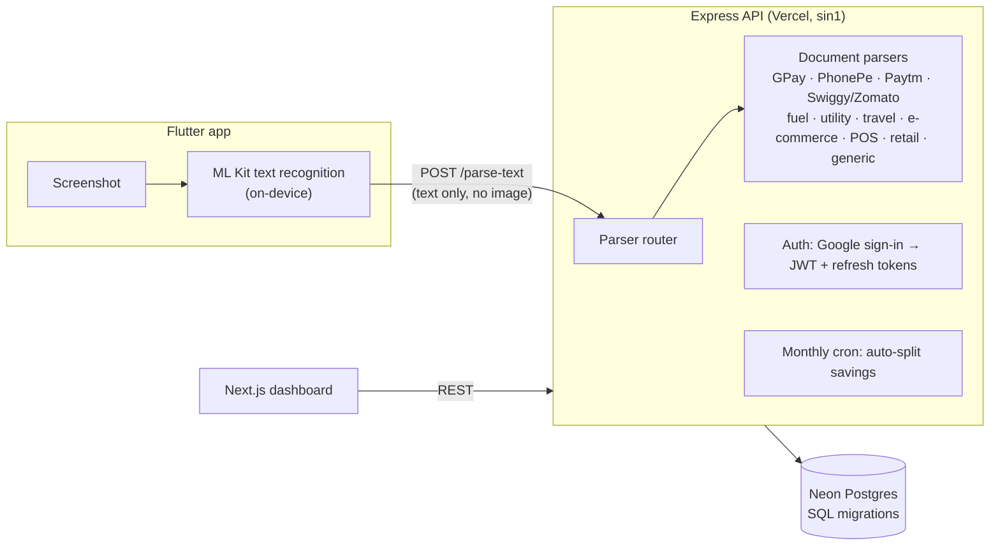

# ExpenseLens

**Expense tracker that turns payment screenshots and receipts into categorised transactions.** Take a screenshot of a UPI payment, a Swiggy order or a fuel receipt; the phone reads the text on-device, the API works out which kind of document it is, pulls out the amount, merchant and date, and files it under a category.

Flutter app (Android/iOS) and a Next.js web dashboard, both on one Express + Postgres API.

## Architecture



- **OCR stays on the phone.** The app runs Google ML Kit text recognition locally and sends only the extracted text to `POST /parse-text`, so images never leave the device. A legacy `POST /parse-receipt` endpoint still accepts an image and runs Tesseract.js server-side.
- **Detect, then parse.** `server/src/parsers/index.js` checks the text against detectors in a fixed order (utility bill, fuel receipt, e-commerce invoice, travel ticket, retail/POS invoice, food delivery, PhonePe, GPay, Paytm) and hands it to that document's parser; anything unrecognised goes to a generic parser. One parser per format keeps each one small and testable instead of one regex soup.
- **Auth:** the app signs in with Google; the API verifies the Google ID token and issues its own short-lived JWT plus a refresh token that rotates on every use. Refresh tokens belong to a family: if one that was already rotated away is presented again, it can only have leaked, so the whole family is revoked (`server/src/lib/tokens.js`). Logout and logout-everywhere are supported.
- **Money features:** budgets per category, income, savings goals with deadlines, a monthly job that moves a share of income into savings (`/jobs/auto-split-savings`, Vercel Cron, guarded by `CRON_SECRET`), and a PDF report (`GET /report`, pdfkit).

## Repository layout

| Path | What |
|---|---|
| `app/` | Flutter app: Google sign-in, screenshot scanning, `fl_chart` dashboards |
| `server/` | Express 5 API, parsers, SQL migrations, cron job (`vercel.json`) |
| `web/` | Next.js dashboard: transactions, budgets, income, savings |

## API

All routes except `/auth/login`, `/auth/refresh` and `/jobs/*` need `Authorization: Bearer <jwt>`.

| Route | |
|---|---|
| `POST /auth/login`, `/auth/refresh`, `/auth/logout`, `/auth/logout-all`; `GET/PATCH /auth/me` | Google sign-in, token refresh, sessions |
| `POST /parse-text {text}` | Parse OCR text into a draft transaction |
| `POST /parse-receipt` (multipart `receipt`) | Legacy: server-side Tesseract OCR, then parse |
| `GET/POST/PATCH/DELETE /transactions` | Transactions |
| `GET/POST/PATCH/DELETE /incomes`, `/savings` | Income and savings goals |
| `GET/PUT /budgets` | Per-category budgets |
| `GET /summary`, `GET /report` | Monthly summary; PDF report |

## Run locally

**API**

```bash
cd server
npm install
cat > .env <<'ENV'
DATABASE_URL=postgres://...          # Neon or any Postgres
GOOGLE_CLIENT_ID=...apps.googleusercontent.com
JWT_SECRET=change-me
CRON_SECRET=change-me
ENV
npm run migrate      # applies migrations/*.sql in order
npm run seed         # applies seeds/*.sql
npm run dev          # http://localhost:3000
```

**App**

```bash
cd app
flutter pub get
flutter run
```

Point `_baseUrl` in `lib/services/api_client.dart` at your API, and set `serverClientId` in `lib/services/auth_service.dart` to the same Google web client ID as `GOOGLE_CLIENT_ID`.

**Web dashboard**

```bash
cd web
npm install
npm run dev
```

## Deploy

`server/vercel.json` deploys the API as a Vercel function in `sin1` (Singapore, the closest region to India) and schedules the savings job for 00:00 UTC on the 1st of each month.
